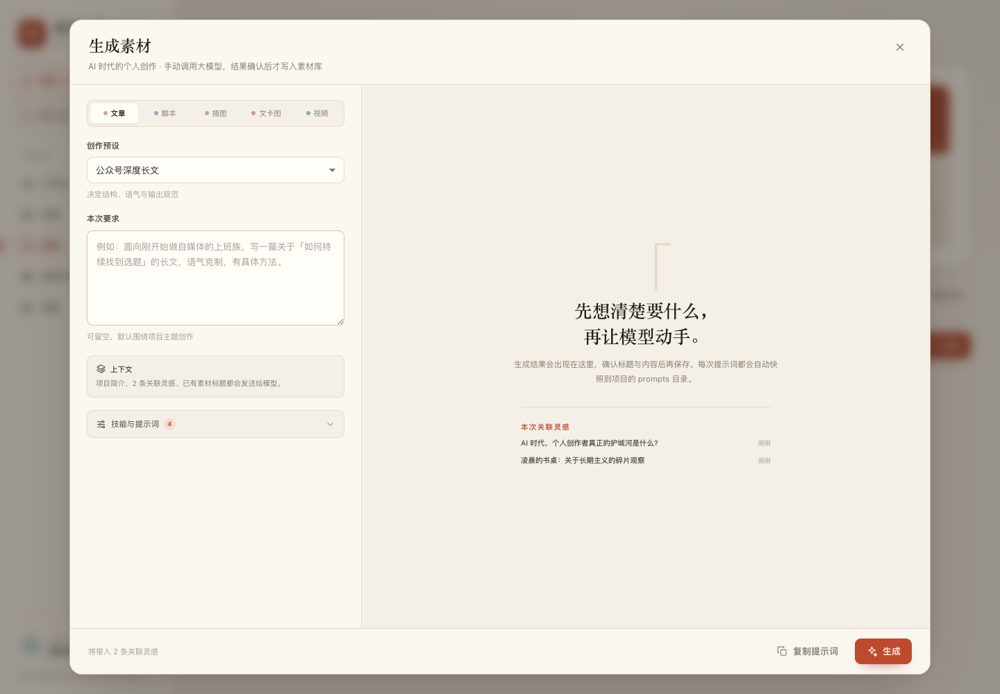
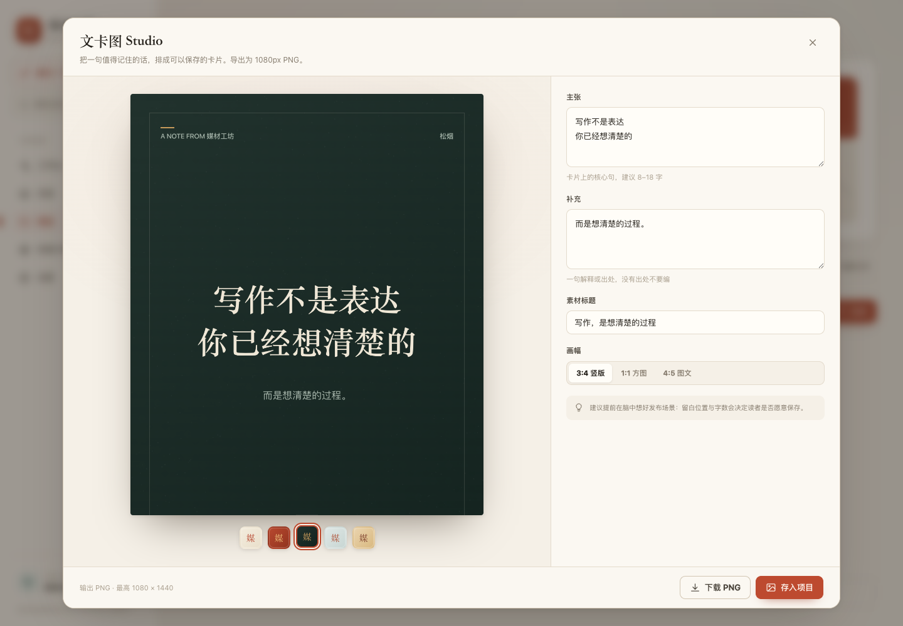
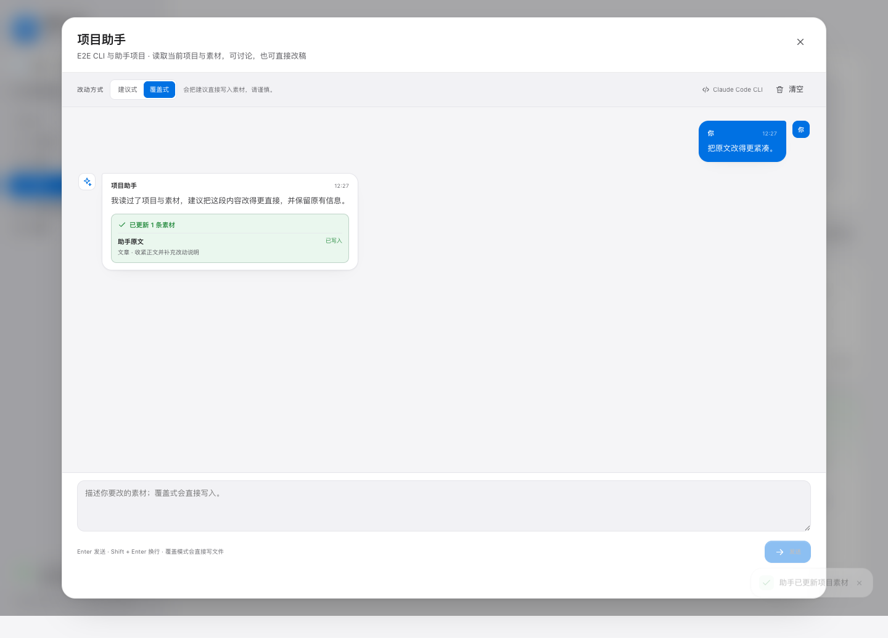
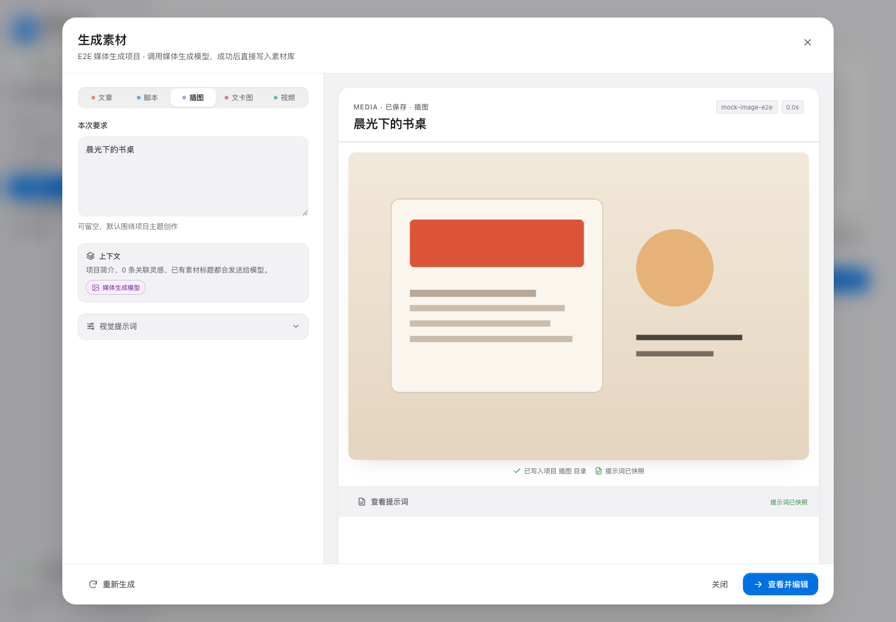
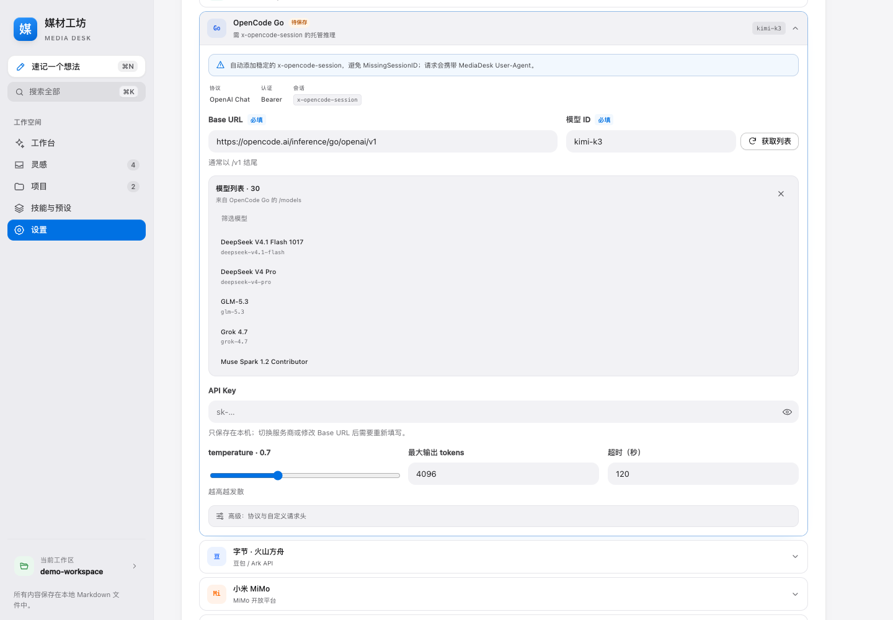
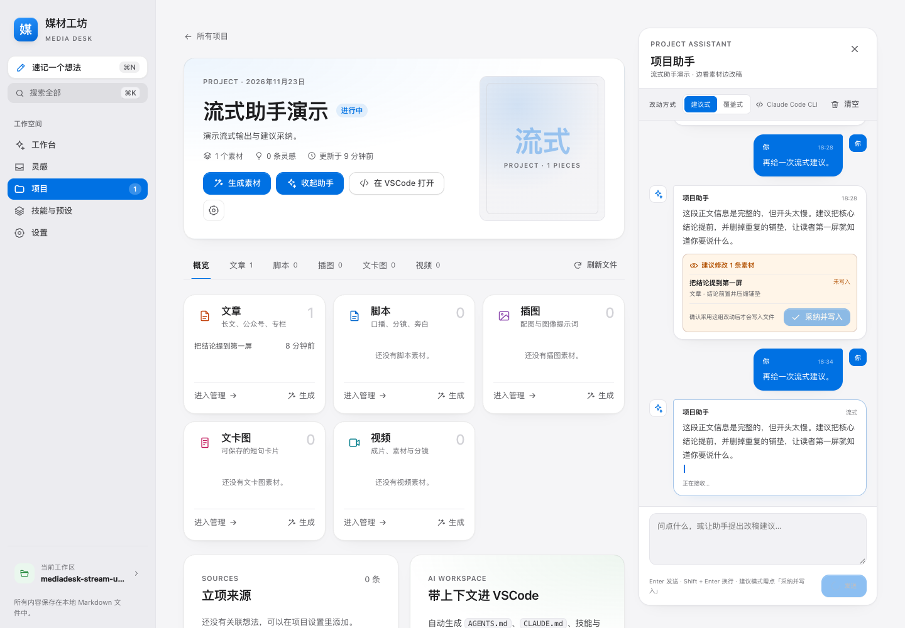
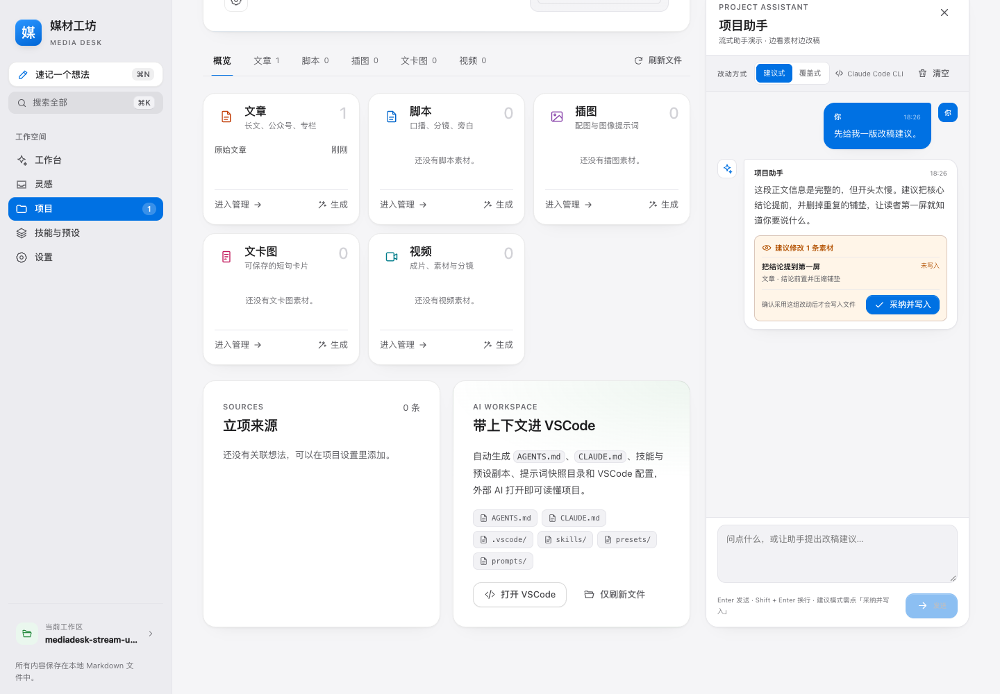

# 媒材工坊 · MediaDesk

> 把「随手想法」变成「可发布素材」的本地工作台。浏览器优先，原生体验收口；Windows / macOS 同一套代码。


## 为什么是它

自媒体创作真正麻烦的不是「写」，而是素材散落、想法丢失、上下文无法交给 AI。MediaDesk 把整个流程做成一个以文件为中心的工作区：

- **灵感收件箱**：`⌘N` 随时速记，标题、正文、标签都是普通 Markdown 文件。
- **从想法立项**：项目独立成页，自动生成文章、脚本、插图、文卡图、视频五类目录。
- **服务商目录与模型列表**：Claude / Codex / OpenCode Go / 字节方舟 / 小米 / OpenRouter / Kimi / MiniMax / DeepSeek / Ollama / 自定义；折叠列表、真实 `/models` 获取、特殊请求头自动处理。
- **文本内核可切换**：文章、脚本、文卡图可走 API，也可调用本机 `claude` / `codex` / `opencode` / `deepseek` CLI；提示词与结果仍可预览、快照。
- **媒体模型直连**：插图走 OpenAI Images 兼容接口，视频支持 OpenAI / 通用 task / Seedance 任务协议，成功后直接落进项目素材库。
- **项目助手右侧栏**：流式接收回复，边生成边阅读；建议式给出「采纳并写入」按钮，确认后才覆盖素材。
- **VSCode 协作**：一键生成 `AGENTS.md`、`CLAUDE.md`、技能/预设副本、`.vscode/` 与机器可读上下文，并调用 `code` 打开项目。
- **文卡图 Studio**：内置 5 套主题与 3 种画幅，Canvas 导出 1080px PNG 并直接入库。
- **本地优先**：无账号、无遥测、无外部字体/CDN；API Key 只存在本机 `.mediadesk/config.json`（Unix 下权限 0600）。

## 界面

| 灵感 | 项目 |
|---|---|
|  |  |

| 生成素材 | 文卡图 Studio |
|---|---|
|  |  |

| 深色模式 | 技能库 |
|---|---|
|  |  |

| 项目助手 | 媒体生成结果 |
|---|---|
|  |  |

| 服务商与模型列表 | 助手流式回复 |
|---|---|
|  |  |

| 建议式采纳 |
|---|
|  |

桌面原生窗口（Tauri 2 + 系统 WKWebView，安装包 3.60MB）：


## 快速开始

### 方式一：浏览器版（推荐先用）

环境：Node 22+、Rust 1.85+。

```bash
npm install
npm run dev
# 打开 http://127.0.0.1:5173
```

生产版是**单二进制**：前端已内嵌，不需要 Node、不需要 `dist/`、不启动额外服务。

```bash
npm run build
cargo build --release -p mediadesk-server
./target/release/mediadesk-server --open
# 默认 http://127.0.0.1:4317
```

常用参数：`--workspace <路径>`、`--port <端口>`、`--no-open`。

### 方式二：桌面原生版（Tauri 2）

```bash
npm run build
npm run app:build
```

macOS 产物：

- `target/release/bundle/macos/媒材工坊.app`
- `target/release/bundle/dmg/*.dmg`

Windows 使用相同 Tauri 配置，在 Windows 上执行 `npx tauri build --bundles nsis` 即生成安装包；仓库内的 GitHub Actions（`.github/workflows/build.yml`）会同时构建 macOS 与 Windows 安装包以及免安装浏览器版二进制。

> 说明：当前版本在 macOS（Apple Silicon）上完成了本机构建与启动验证；Windows 构建配置与 CI 已就绪，但未在 Windows 实机验收。Windows 版可在 Windows 上按上述命令构建，或使用 CI 产物；浏览器版是单文件二进制，无需安装 Node。
> 本机构建未做 Apple 开发者签名/公证；若从网络下载后 macOS 提示「无法验证开发者」，请右键应用 → 打开，或在「系统设置 → 隐私与安全性」中允许。

## 已构建产物（macOS arm64）

| 文件 | 用途 | 大小 |
|---|---|---|
| `release/媒材工坊_0.4.0_aarch64.dmg` | 拖入 Applications 的安装包 | 3.60 MB |
| `release/媒材工坊_0.4.0_aarch64.app.zip` | 免安装应用 | 3.15 MB |
| `release/mediadesk-server-macos-arm64` | 浏览器版单二进制（内嵌 UI） | 3.33 MB |

实测：浏览器服务空载 RSS ≈ 8.6MB，冷启动 0.1–0.6s；原生主进程空载约 35MB、打开工作台约 95MB（系统 WKWebView，进程另计）。完整数据见 [验收记录](docs/ACCEPTANCE.md)。

## 工作流

1. **速记**：侧栏「速记一个想法」或 `⌘N` / `Ctrl+N`。保存后进入「灵感」。
2. **立项**：灵感卡片点「立项」，可编辑项目标题与简介；一个项目可关联多条灵感。
3. **管理五类素材**：
   - 文章 / 脚本：Markdown 编辑器 + 预览；
   - 插图 / 文卡图 / 视频：上传媒体，自动生成同名 `.md` sidecar，记录标题、状态、提示词与备注；
   - 外部放入项目目录的图片/视频，点「刷新文件」会自动收编为素材；
   - 删除进 `.mediadesk/trash/`，可手动恢复。
4. **生成文本素材**：项目页「生成素材」→ 选文章/脚本/文卡图、预设、技能、写要求 → 可先「预览/复制提示词」而不调用模型 → 结果确认标题后「保存为素材」。提示词快照自动写入 `prompts/`。文本走当前选择的文本内核（API 或本机 CLI）。
5. **生成插图和视频**：选插图/视频 → 写画面要求 → 「生成并保存」。媒体模型成功后，文件直接写入 `illustration/` 或 `video/`，sidecar 记录提示词与模型，不需要额外上传。
6. **和项目助手对话**：项目页「助手」→ 右侧栏打开，项目素材仍在左侧可浏览、可打开 → 选择建议式/覆盖式 → 发送。助手读取项目简介、关联灵感与全部素材，回复通过 SSE 流式显示；**建议式**只展示建议，点「采纳并写入」并确认后才覆盖；**覆盖式**直接写入对应素材。
7. **VSCode**：项目页「在 VSCode 打开」。若系统没有 `code` 命令，会明确提示并给出可复制的手动命令，同时上下文文件已经生成。
8. **沉淀方法**：「技能与预设」里编辑方法论与各类素材的写作规范；项目设置可勾选要随项目复制的技能/预设。

全局搜索：`⌘K` / `Ctrl+K`。

## 文本内核

「设置 → 文本内核」决定文章、脚本、文卡图由谁生成：

| 内核 | 行为 |
|---|---|
| API 大模型 | 使用「大模型接入」里的 OpenAI-compatible Chat Completions 接口 |
| Claude Code | 调用本机 `claude` CLI，stdin 传完整提示词 |
| Codex CLI | 调用本机 `codex exec {prompt}` |
| OpenCode | 调用本机 `opencode` CLI |
| DeepSeek CLI | 调用本机 `deepseek` CLI |

- 自动从 `PATH` 探测；也可填写绝对路径，或用 `MEDIADESK_CLI_BIN` 环境变量覆盖。
- 子进程的 cwd 锁定当前项目目录；超时、找不到、非零退出都有明确错误码（`CLI_NOT_FOUND` / `CLI_TIMEOUT` / `CLI_FAILED`）。
- 默认参数因内核而异（如 Claude 用 `-p`）；可在「附加参数」里修改，支持 `{prompt}` 占位符。
- 项目助手对 Claude Code 使用 `-p --output-format stream-json --verbose --include-partial-messages`，把文本增量转发到界面；普通素材生成仍使用非流式输出。
- API 助手使用 OpenAI / Anthropic / Responses 的流式 SSE；若网关不支持流式，会自动回退到普通响应。
- 本机未安装 CLI 时，切换到 API 即可继续使用；插图和视频始终走媒体模型。

## 服务商与模型列表

「设置 → 大模型接入」是**折叠列表**：默认只显示服务商名称，点击一项才展开 Base URL、Key、模型与高级选项，避免一屏堆满所有厂商。

内置服务商：

| 服务商 | 协议 / 特殊处理 |
|---|---|
| DeepSeek | OpenAI Chat；官方 `/models` |
| Claude / Claude Code | Anthropic Messages；`x-api-key` + `anthropic-version: 2023-06-01` |
| Codex / OpenAI | OpenAI Responses（`/responses`），适合 Codex 模型 |
| OpenAI | 标准 Chat Completions |
| OpenCode Go | **自动附加 `x-opencode-session`**，避免 `MissingSessionID`；固定 Base URL 为 `/inference/go/openai/v1` |
| 字节 · 火山方舟 | OpenAI 兼容；模型 ID 或推理接入点 `ep-...` |
| 小米 MiMo | OpenAI 兼容；`api.xiaomimimo.com/v1` |
| OpenRouter | OpenAI 兼容；自动附加 `HTTP-Referer` / `X-Title` |
| Kimi | OpenAI 兼容；`api.moonshot.cn/v1` |
| MiniMax | OpenAI 兼容；国际站 `api.minimaxi.com/v1`，国内站可改 `api.minimax.chat/v1` |
| Ollama 本地 | 无需 Key |
| 自定义服务 | 可选 OpenAI / Anthropic / Responses 协议，自定义请求头 |

- 每个服务商行可展开/收起；同一时间只展开一个。支持搜索过滤。
- 展开后点「获取列表」会通过本地 Rust 服务请求服务商的 `/models`，归一化后以可搜索列表展示；模型名可手动修改。
- 模型列表请求同样会带上服务商特殊 header；Key 不会进入前端 URL 或日志。
- OpenCode Go 已用真实接口验证：模型列表可获取；带无效 Key 时返回 401 `Invalid credential`，不再出现 `MissingSessionID`。
- 切换服务商会清空当前输入框中的 Key，避免把上一家的 Key 发到别家；保存后 API Key 仍只保存在本机。
- 「测试连接」会按当前协议真实发一次最小请求。


## 媒体生成

「设置 → 媒体生成」分别配置图像与视频模型：

- **Base URL / 模型 ID / API Key / 风格**；风格会自动附加到视觉提示词。
- **图像**：OpenAI Images 兼容 `POST {base}/images/generations`，支持响应里的 `data[0].url`、`data[0].b64_json`，也支持自定义创建路径。
- **视频**：支持三种协议：
  - `openai`：`POST {base}/videos`，轮询任务，完成后下载视频；
  - `task`：通用异步创建/轮询；
  - `seedance`：方舟/Seedance 的 `/contents/generations/tasks` 创建与状态查询。
- 状态路径支持 `{id}` 占位；轮询间隔、请求超时和视频任务超时都可配置。
- 成功后文件直接写入项目 `illustration/` 或 `video/`，并生成 sidecar 与提示词快照；`source=media-gen`。
- 失败时返回 `MEDIA_NOT_CONFIGURED` / `MEDIA_GEN_FAILED`，保留服务商错误摘要（Key 会打码）。

## 项目助手

- 入口在项目页「助手」，以**右侧栏**停靠：桌面端与项目内容并排，素材可继续浏览和打开；窄屏切换为侧滑抽屉。会话历史保存到 `projects/<项目>/.mediadesk/assistant/history.json`（隐藏目录，不会被文件接口暴露）。
- 助手读取项目、关联灵感和全部素材，通过当前文本内核回复；回复通过 SSE 实时显示，界面会展示当前阶段、已接收文本与等待秒数。
- **流式 CLI**：Claude Code 使用 stream-json 增量；其他 CLI 直接转发 stdout 增量。自定义参数会优先于默认流式参数。
- **流式 API**：OpenAI Chat、Anthropic Messages、OpenAI Responses 均解析 SSE；非 SSE 网关自动回退。
- **建议式**：只展示修改建议，不改文件；每条建议下方有「采纳并写入」按钮，确认后由服务端应用并标记 `applied`，刷新/重启后按钮不会重复出现。
- **覆盖式**：把 `edits` 里的完整 `content` / `title` 直接写入对应素材；服务端只接受项目内真实 assetId。
- 模型必须输出约定 JSON；无法解析时退化为普通对话，不会误改素材。

## 工作区结构

```
<Workspace>/
├── .mediadesk/            # 技能、预设、配置、回收站
├── ideas/                 # 每条想法一个 .md
└── projects/<项目>/
    ├── project.md
    ├── article/ script/ illustration/ card/ video/
    ├── prompts/           # 每次生成的完整提示词快照
    ├── skills/ presets/   # 选中内容的副本，给外部 AI 读
    ├── AGENTS.md CLAUDE.md README.md
    ├── .mediadesk/context.json
    └── .vscode/
```

在设置中可以随时更换工作区；默认位置是 `~/Documents/MediaDesk`（macOS / Windows 用户文档目录）。工作区可放进 Git、iCloud 或移动硬盘。

## 设计原则

- **文件是数据库**：没有 SQLite / 私有格式，LLM 与编辑器都能直接读懂。
- **小体积、低占用**：Preact 前端约 222KB JS（gzip 约 74KB）；Rust 服务常驻内存只有几十 MB；桌面壳使用系统 WebView（WKWebView / WebView2），安装包不含 Chromium。
- **无外部运行时**：字体、图标、依赖全部本地；生产浏览器版是内嵌 UI 的单文件二进制。
- **UI**：暖纸色、墨色、朱砂强调、宋体标题的编辑部质感；支持明暗主题与移动端布局。
- **安全**：只监听 `127.0.0.1`；文件接口限定在 `projects/` 且拒绝隐藏文件、路径穿越与符号链接逃逸；Markdown 预览经 DOMPurify 清洗。

## 开发与验证

```bash
npm run typecheck      # TypeScript
npm test               # Vitest 纯函数测试
cargo test --workspace --exclude mediadesk-desktop
npm run e2e            # Playwright：真实 Rust 服务 + mock LLM/媒体 + mock CLI + fake code CLI
cargo clippy -p mediadesk-core -p mediadesk-server --all-targets -- -D warnings
```

E2E 覆盖：速记 → 立项 → 手写文章 → 设置并测试模型 → 生成/保存 → VSCode 上下文 → 上传插图 → 灯箱 → 文卡图导出 → 项目设置 → 技能创建 → 全局搜索 → 删除进回收站 → 深色主题持久化；移动端抽屉导航；切换工作区；CLI 文本内核 → 项目助手流式建议 → 「采纳并写入」覆盖素材；媒体生成并落盘；服务商折叠、模型列表获取与搜索。

Playwright 默认直接驱动系统 Microsoft Edge，不额外下载 Chromium；CI 无 Edge 时可用 `CHROMIUM_PATH` 指定托管浏览器，或设置 `PW_BROWSER=chromium`。

更多： [架构设计](docs/ARCHITECTURE.md) · [实施计划](docs/superpowers/plans/2026-11-20-media-desk.md) · [验收记录](docs/ACCEPTANCE.md)

## 已知边界

- 本机安装的 `claude` 已检测到，但未用真实账号发起生成；`opencode` / `codex` / `deepseek` CLI 是否安装取决于机器，未安装时会明确报错。CLI 测试使用 mock CLI；Claude stream-json 的增量解析用 mock 事件验证，未对真实账号/每种 CLI 参数组合做验收。
- 服务商模型列表接口已对 OpenRouter / OpenCode Go 做真实网络验证；其他厂商使用通用 `/models` 解析，需要用户自己的 Key，未逐一用真实账号验证。
- Anthropic Messages 与 OpenAI Responses 协议通过本地 mock 验证，未用真实付费账号发起请求。
- 媒体接口的兼容范围是 OpenAI Images、OpenAI Videos、通用 task 与 Seedance；不同厂商的额外字段/签名方式可能需要通过创建路径和风格适配。
- 当前 macOS 构建为 Apple Silicon（arm64）；未提供 Intel / universal 包。
- 普通素材生成仍为非流式，长文生成时界面显示等待态；项目助手已使用流式。
- 单用户本地应用，无多端同步与协作。
- Windows 未在本机实机运行；CI 构建配置已提供。
- 不包含代码签名与公证；对外分发时需配置 Apple Developer / Windows 证书。

## License

MIT
