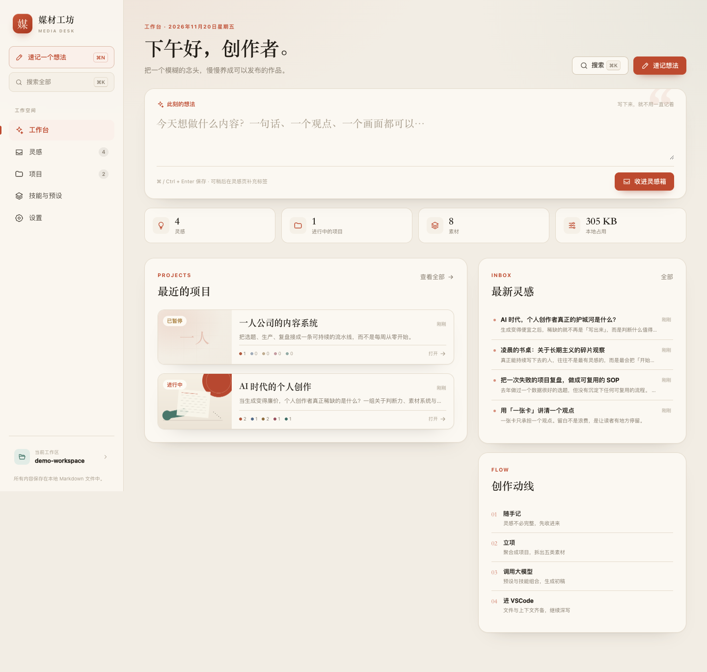
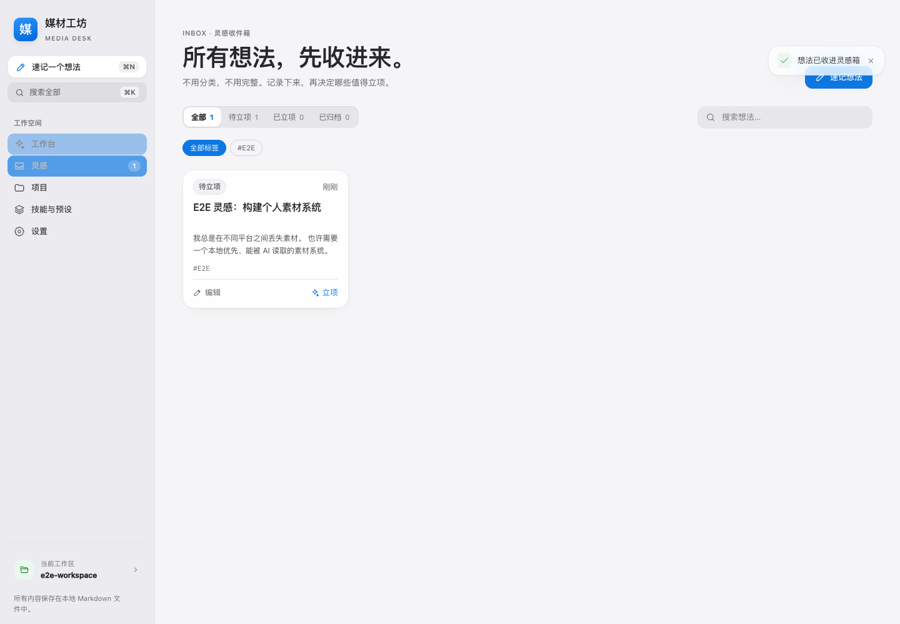
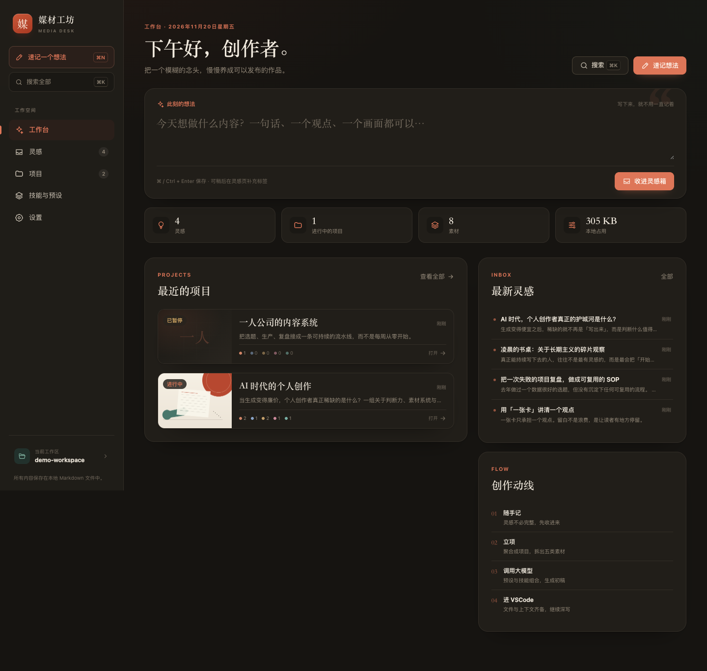
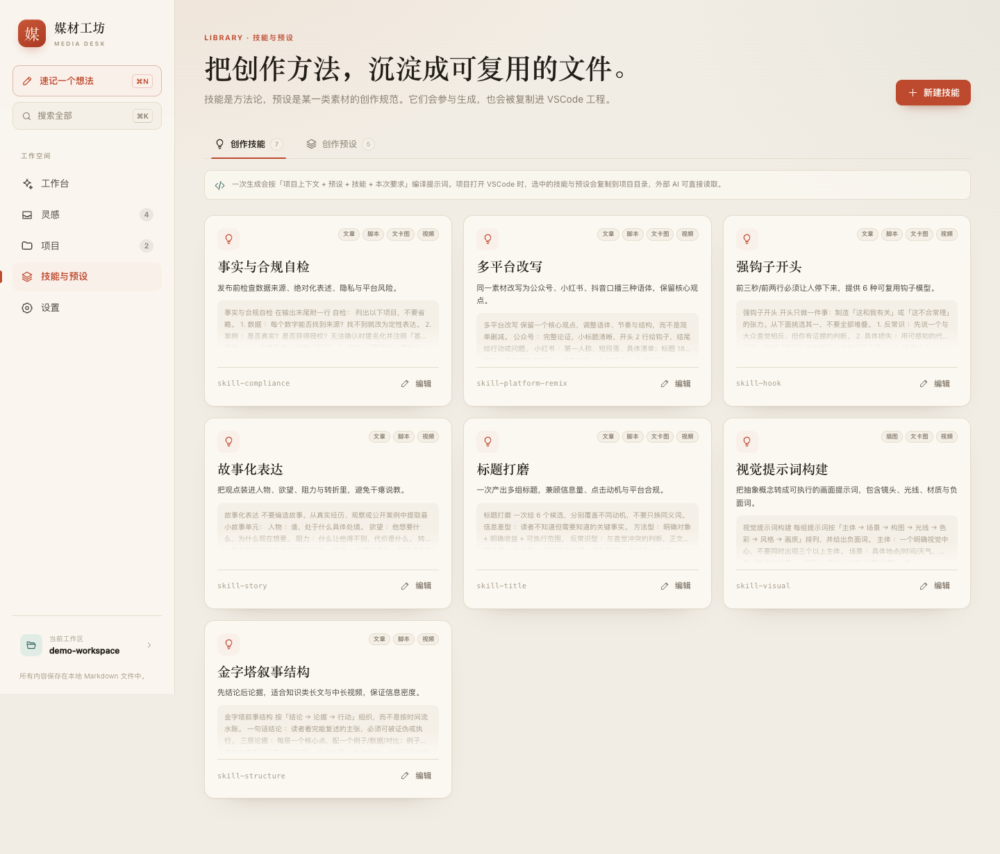

# 媒材工坊 · MediaDesk

> 把「随手想法」变成「可发布素材」的本地工作台。浏览器优先，原生体验收口；Windows / macOS 同一套代码。



## 为什么是它

自媒体创作真正麻烦的不是「写」，而是素材散落、想法丢失、上下文无法交给 AI。MediaDesk 把整个流程做成一个以文件为中心的工作区：

- **灵感收件箱**：`⌘N` 随时速记，标题、正文、标签都是普通 Markdown 文件。
- **从想法立项**：项目独立成页，自动生成文章、脚本、插图、文卡图、视频五类目录。
- **手动调用大模型**：项目上下文 + 创作预设 + 技能 + 本次要求，编译成可复用的提示词；确认结果后才入库。
- **VSCode 协作**：一键生成 `AGENTS.md`、`CLAUDE.md`、技能/预设副本、`.vscode/` 与机器可读上下文，并调用 `code` 打开项目。
- **文卡图 Studio**：内置 5 套主题与 3 种画幅，Canvas 导出 1080px PNG 并直接入库。
- **本地优先**：无账号、无遥测、无外部字体/CDN；API Key 只存在本机 `.mediadesk/config.json`（Unix 下权限 0600）。

## 界面

| 灵感 | 项目 |
|---|---|
|  |  |

| 生成素材 | 文卡图 Studio |
|---|---|
|  |  |

| 深色模式 | 技能库 |
|---|---|
|  |  |

桌面原生窗口（Tauri 2 + 系统 WKWebView，安装包 3.4MB）：


## 快速开始

### 方式一：浏览器版（推荐先用）

环境：Node 22+、Rust 1.85+。

```bash
npm install
npm run dev
# 打开 http://127.0.0.1:5173
```

生产版是**单二进制**：前端已内嵌，不需要 Node、不需要 `dist/`、不启动额外服务。

```bash
npm run build
cargo build --release -p mediadesk-server
./target/release/mediadesk-server --open
# 默认 http://127.0.0.1:4317
```

常用参数：`--workspace <路径>`、`--port <端口>`、`--no-open`。

### 方式二：桌面原生版（Tauri 2）

```bash
npm run build
npm run app:build
```

macOS 产物：

- `target/release/bundle/macos/媒材工坊.app`
- `target/release/bundle/dmg/*.dmg`

Windows 使用相同 Tauri 配置，在 Windows 上执行 `npx tauri build --bundles nsis` 即生成安装包；仓库内的 GitHub Actions（`.github/workflows/build.yml`）会同时构建 macOS 与 Windows 安装包以及免安装浏览器版二进制。

> 说明：当前版本在 macOS（Apple Silicon）上完成了本机构建与启动验证；Windows 构建配置与 CI 已就绪，但未在 Windows 实机验收。Windows 版可在 Windows 上按上述命令构建，或使用 CI 产物；浏览器版是单文件二进制，无需安装 Node。
> 本机构建未做 Apple 开发者签名/公证；若从网络下载后 macOS 提示「无法验证开发者」，请右键应用 → 打开，或在「系统设置 → 隐私与安全性」中允许。

## 已构建产物（macOS arm64）

| 文件 | 用途 | 大小 |
|---|---|---|
| `release/媒材工坊_0.1.0_aarch64.dmg` | 拖入 Applications 的安装包 | 3.41 MB |
| `release/媒材工坊_0.1.0_aarch64.app.zip` | 免安装应用 | 3.0 MB |
| `release/mediadesk-server-macos-arm64` | 浏览器版单二进制（内嵌 UI） | 3.0 MB |

实测：浏览器服务空载 RSS ≈ 8.3MB，冷启动 0.1–0.7s；原生主进程空载约 35MB、打开工作台约 98MB（系统 WKWebView，进程另计）。完整数据见 [验收记录](docs/ACCEPTANCE.md)。

## 工作流

1. **速记**：侧栏「速记一个想法」或 `⌘N` / `Ctrl+N`。保存后进入「灵感」。
2. **立项**：灵感卡片点「立项」，可编辑项目标题与简介；一个项目可关联多条灵感。
3. **管理五类素材**：
   - 文章 / 脚本：Markdown 编辑器 + 预览；
   - 插图 / 文卡图 / 视频：上传媒体，自动生成同名 `.md` sidecar，记录标题、状态、提示词与备注；
   - 外部放入项目目录的图片/视频，点「刷新文件」会自动收编为素材；
   - 删除进 `.mediadesk/trash/`，可手动恢复。
4. **生成素材**：项目页「生成素材」→ 选类型、预设、技能、写要求 → 可先「预览/复制提示词」而不调用模型 → 生成结果确认标题后「保存为素材」。提示词快照自动写入 `prompts/`。
5. **VSCode**：项目页「在 VSCode 打开」。若系统没有 `code` 命令，会明确提示并给出可复制的手动命令，同时上下文文件已经生成。
6. **沉淀方法**：「技能与预设」里编辑方法论与各类素材的写作规范；项目设置可勾选要随项目复制的技能/预设。

全局搜索：`⌘K` / `Ctrl+K`。

## 大模型配置

「设置 → 大模型接入」支持任意 OpenAI-compatible Chat Completions 服务，内置 DeepSeek / OpenAI / Moonshot / Ollama 快捷配置：

- Base URL 通常以 `/v1` 结尾；
- 模型名可自由填写；
- API Key 保存在本机，前端只看到「是否已配置」，接口不会回传明文；
- 「测试连接」会真实发起一次最小请求；
- 本地 Ollama（`http://localhost:11434/v1`）可以不填 Key；
- 没有 Key 或断网时，仍可「预览/复制提示词」，把上下文带去任意模型。

**关于图像生成**：v0.1 调用文本模型生成插图提示词与文卡文案；文卡图可以直接在 Studio 里排版导出 PNG。把插图提示词交给 Midjourney / 即梦 / SD 等图像模型，再上传图片即可完成插图素材。没有假装已经直连图像模型。

## 工作区结构

```
<Workspace>/
├── .mediadesk/            # 技能、预设、配置、回收站
├── ideas/                 # 每条想法一个 .md
└── projects/<项目>/
    ├── project.md
    ├── article/ script/ illustration/ card/ video/
    ├── prompts/           # 每次生成的完整提示词快照
    ├── skills/ presets/   # 选中内容的副本，给外部 AI 读
    ├── AGENTS.md CLAUDE.md README.md
    ├── .mediadesk/context.json
    └── .vscode/
```

在设置中可以随时更换工作区；默认位置是 `~/Documents/MediaDesk`（macOS / Windows 用户文档目录）。工作区可放进 Git、iCloud 或移动硬盘。

## 设计原则

- **文件是数据库**：没有 SQLite / 私有格式，LLM 与编辑器都能直接读懂。
- **小体积、低占用**：Preact 前端约 203KB JS（gzip 约 68KB）；Rust 服务常驻内存只有几十 MB；桌面壳使用系统 WebView（WKWebView / WebView2），安装包不含 Chromium。
- **无外部运行时**：字体、图标、依赖全部本地；生产浏览器版是内嵌 UI 的单文件二进制。
- **UI**：暖纸色、墨色、朱砂强调、宋体标题的编辑部质感；支持明暗主题与移动端布局。
- **安全**：只监听 `127.0.0.1`；文件接口限定在 `projects/` 且拒绝隐藏文件、路径穿越与符号链接逃逸；Markdown 预览经 DOMPurify 清洗。

## 开发与验证

```bash
npm run typecheck      # TypeScript
npm test               # Vitest 纯函数测试
cargo test --workspace --exclude mediadesk-desktop
npm run e2e            # Playwright：真实 Rust 服务 + mock LLM + fake code CLI
cargo clippy -p mediadesk-core -p mediadesk-server --all-targets -- -D warnings
```

E2E 覆盖：速记 → 立项 → 手写文章 → 设置并测试模型 → 生成/保存 → VSCode 上下文 → 上传插图 → 灯箱 → 文卡图导出 → 项目设置 → 技能创建 → 全局搜索 → 删除进回收站 → 深色主题持久化；以及移动端抽屉导航与速记。

更多： [架构设计](docs/ARCHITECTURE.md) · [实施计划](docs/superpowers/plans/2026-11-20-media-desk.md) · [验收记录](docs/ACCEPTANCE.md)

## 已知边界

- 未直连图像/视频生成模型；文卡图可本地生成，其余媒体以提示词 + 上传管理为主。
- 当前 macOS 构建为 Apple Silicon（arm64）；未提供 Intel / universal 包。
- LLM 调用为非流式，长文生成时界面显示等待态。
- 单用户本地应用，无多端同步与协作。
- Windows 未在本机实机运行；CI 构建配置已提供。
- 不包含代码签名与公证；对外分发时需配置 Apple Developer / Windows 证书。

## License

MIT
